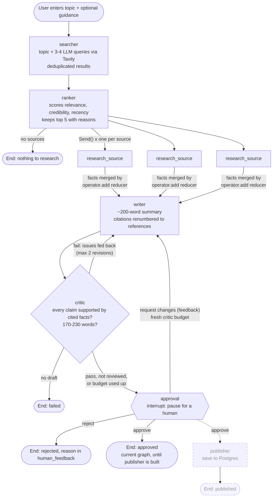

# Automated Content Creation (multi-agent, LangGraph)

A multi-agent pipeline built with **LangGraph**. The user enters a topic. Agents search the web, rank the sources, research the topic and write a short (~200-word) summary with citations. A critic agent fact-checks the draft, and a human approves it before it is published.

This is a portfolio project meant to be deployed and shown, not a toy demo.

## Phases

| Phase | Scope |
|---|---|
| **Phase 1 (MVP)** | User enters a topic → search → rank → research → write → critic loop → **human approval** → publish (saved to Postgres and shown on an archive page) |
| Phase 2 | **Trend Scout** agent finds trending topics from Google Trends RSS, Hacker News, Wikipedia pageviews and Reddit; the human picks one or enters their own (first human-in-the-loop checkpoint) |
| Phase 3 (stretch) | Scheduled daily runs, short video generation (script → TTS → video), social posting, evals dashboard |

## Phase 1 graph

Solid boxes are built; dashed boxes are planned.



The **critic loop** is the graph's first cycle. `route_after_critic` returns `"writer"` on a fail, sending the draft back with the critic's notes as revision feedback, and `"approval"` otherwise, so a pass, a skipped review (`critic_passed=None`, fail open) and a used-up budget (after 2 revisions) all reach a human. Only a run with no draft at all ends early, with `status="failed"`. Pass/fail is decided in code: the LLM only lists unsupported sentences (quote, problem, fix), and the word count (170-230) is checked deterministically. The length check is skipped while an editor's feedback is set, so a request like "cut it to 120 words" is not undone by the critic.

The research step is a **map-reduce fan-out**: `fan_out_to_researchers` returns one `Send("research_source", ResearchTask)` per ranked source, so the workers run in parallel and each one sees only its own source. Each worker returns `{"facts": [...]}`, and the `operator.add` reducer on `State.facts` concatenates the results instead of letting the last worker overwrite the others.

The **approval** node uses LangGraph `interrupt()`. The graph pauses and its state is saved by the checkpointer (`InMemorySaver` in notebooks, Postgres planned for the API). The reviewer sees the draft, references, the critic's verdict (`passed`, `not_reviewed` or `budget_exhausted`) and, when the budget ran out, the critic's unresolved issues. The run resumes with `Command(resume={"action": ..., "feedback": ...})`:

| Action | Effect |
|---|---|
| `approve` | `status="approved"`, end (the publisher will go here) |
| `request_changes` | feedback (required) goes to the writer; `revision_count` resets so the rewrite gets a fresh critic budget |
| `reject` | `status="rejected"`, the reason is kept in `human_feedback`, end |

The node routes itself by returning `Command(update=..., goto=...)`; its `Command[Literal["writer", "__end__"]]` return type tells LangGraph the possible targets, so `builder.py` adds no edges out of it. An invalid decision does not raise: the node calls `interrupt()` again with an `error` in the payload, and the run stays paused. On resume LangGraph re-runs the node from the top, so nothing before `interrupt()` has side effects. [research/approval.ipynb](research/approval.ipynb) walks through approve, request changes and reject, starting from saved research.

## Shared state

Defined in [content_agent/graph/state.py](content_agent/graph/state.py):

```python
class State(TypedDict):
    # Input
    topic: str
    topic_source: Literal["user", "scout"]   # "scout" used in phase 2
    guidance: str | None                     # optional angle / audience note

    # Written by agents
    search_queries: list[str]
    search_results: list[SearchResult]       # searcher: url, title, snippet
    sources: list[RankedSource]              # ranker: + score, rank_reason (top 5)
    facts: Annotated[list[Fact], operator.add]   # research workers append in parallel
    draft: str                               # writer: text with [n] citation markers
    references: list[str]                    # writer: references[n-1] is the URL for [n]

    # Critic loop
    critic_notes: Annotated[list[str], operator.add]   # appended, never overwritten
    critic_passed: bool | None               # None = critic could not run
    revision_count: int

    # Human approval
    human_feedback: str | None
    status: Literal["queued", "researching", "awaiting_approval", "approved", "rejected", "failed"]
```

`ResearchTask` (topic, guidance, one `RankedSource`) is the private input each `research_source` worker receives through `Send`; it is not part of `State`. Likewise `ApprovalDecision` (`action`, `feedback`) is the resume value the approval node reads; only its effects are written to `State`. The node writes only the end states `approved` / `rejected`; while a run is paused, "awaiting approval" is read from the checkpoint rather than stored.

## Project structure

```
AutomatedContentCreation/
├── requirements.txt          # runtime dependencies
├── requirements-dev.txt      # dev tools (pytest, ruff, ipykernel, python-dotenv)
├── .env                      # API keys (git-ignored, see Setup)
├── docker-compose.yml        # local Postgres
├── .vscode/settings.json     # notebooks run from the project root
├── research/                 # notebooks + sample JSON: experiments before code moves into modules
│   ├── explore.ipynb
│   ├── search.ipynb / searcher.ipynb / ranker.ipynb / researcher.ipynb
│   ├── approval.ipynb        # interrupt + resume: approve, request changes, reject
│   └── sample_search.json, sample_state.json
├── content_agent/
│   ├── llm.py                # get_llm(role) / get_structured_llm(role, schema), per-role model via env
│   ├── graph/
│   │   ├── state.py          # State, SearchResult, RankedSource, Fact, ResearchTask, ApprovalDecision
│   │   ├── prompts.py        # all LLM prompts
│   │   ├── builder.py        # wires nodes + edges into the graph
│   │   └── nodes/
│   │       ├── searcher.py   # plans queries, runs Tavily, deduplicates
│   │       ├── ranker.py     # scores and keeps top 5
│   │       ├── researcher.py # Send fan-out + per-source fact extraction
│   │       ├── writer.py     # draft + citation renumbering, revision prompt
│   │       ├── critic.py     # support + length check, routes to writer / approval / END
│   │       ├── approval.py   # human-in-the-loop interrupt, routes with Command
│   │       └── publisher.py  # (planned)
│   ├── tools/
│   │   ├── search.py         # Tavily wrapper
│   │   └── fetch.py          # httpx + trafilatura page text extraction
│   └── api/
│       ├── main.py           # FastAPI app (in-memory runs, not yet wired to the graph)
│       └── schemas.py        # request/response models
├── ui/
│   └── app.py                # Streamlit UI: topic form, calls the API at $API_URL
└── tests/                    # (planned)
```

## Tech stack

- **LangGraph**: agent orchestration, conditional edges, interrupts
- **LangChain** (`init_chat_model`) with Anthropic Claude: LLM calls; structured output uses native JSON schema (`method="json_schema"`). Provider and model are set per role via `LLM_MODEL_<ROLE>` / `LLM_MODEL`
- **Tavily**: web search; **httpx + trafilatura**: page fetching and text extraction
- **Postgres** + `langgraph-checkpoint-postgres`: durable graph state
- **FastAPI + Uvicorn**: API
- **Streamlit**: minimal UI
- **LangSmith**: tracing / observability

## Setup (pip)

```bash
python -m venv .venv
source .venv/bin/activate              # Windows: .venv\Scripts\activate
python -m pip install -r requirements-dev.txt
docker compose up -d                   # start Postgres
```

Create `.env` in the project root with `ANTHROPIC_API_KEY` and `TAVILY_API_KEY`. Optional: `LLM_MODEL` or `LLM_MODEL_<ROLE>` (e.g. `LLM_MODEL_WRITER`) to override the default model, `LANGSMITH_*` for tracing, and `DATABASE_URL` once the checkpointer lands.

Run commands from the project root:

```bash
uvicorn content_agent.api.main:app --reload   # API on :8000
streamlit run ui/app.py                       # UI (API_URL defaults to http://localhost:8000)
```

## Planned API

| Method | Endpoint | Purpose |
|---|---|---|
| POST | `/runs` | Start a run with `{topic, guidance}` |
| GET | `/runs/{id}` | Run status, sources, draft |
| POST | `/runs/{id}/resume` | Human decision: `approve` / `request_changes` (+ feedback) / `reject` |

## Status

- [x] Project structure and dependencies
- [x] Local env + VS Code notebook setup
- [x] `state.py`: State schema
- [x] Tools: search + fetch (prototyped in `research/` notebooks)
- [x] Nodes: searcher → ranker → researcher (parallel `Send`) → writer
- [x] `llm.py`: per-role models, native JSON-schema structured output
- [ ] Researcher prompt: stop meta-facts ("the source does not state...")
- [x] Critic node + revision loop
- [x] `failed` status for no-draft runs
- [ ] `failed` status for no-sources runs (ranker currently ends without setting a status)
- [x] Human approval interrupt (approve / request changes / reject), tested with `InMemorySaver`
- [ ] Postgres checkpointer
- [ ] FastAPI endpoints (`POST /runs`, `GET /runs/{id}` exist with in-memory storage; not wired to the graph)
- [ ] Minimal UI: topic input (done), live run view, approval screen
- [ ] Deploy
