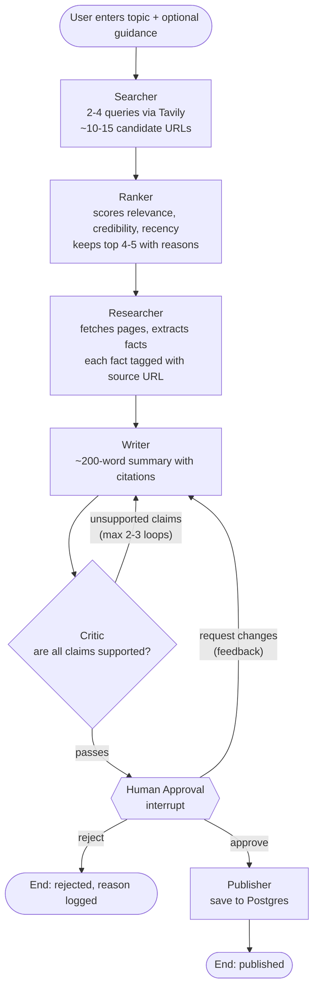

# Automated Content Creation (multi-agent, LangGraph)

A multi-agent pipeline built with **LangGraph**. The user enters a topic. Agents search the web, rank the sources, research the topic and write a short (~200-word) summary with citations. A critic agent fact-checks the draft, and a human approves it before it is published.

This is a portfolio project meant to be deployed and shown, not a toy demo.

## Phases

| Phase | Scope |
|---|---|
| **Phase 1 (MVP)** | User enters a topic → search → rank → research → write → critic loop → **human approval** → publish (saved to Postgres and shown on an archive page) |
| Phase 2 | **Trend Scout** agent finds trending topics from Google Trends RSS, Hacker News, Wikipedia pageviews and Reddit; the human picks one or enters their own (first human-in-the-loop checkpoint) |
| Phase 3 (stretch) | Scheduled daily runs, short video generation (script → TTS → video), social posting, evals dashboard |

## Phase 1 graph



The human approval step uses LangGraph `interrupt()`. The graph pauses, its state is saved by the **Postgres checkpointer**, and the run resumes later through `Command(resume=...)` when the user approves, requests changes or rejects.

## Shared state (draft)

```python
class State(TypedDict):
    topic: str
    topic_source: Literal["user", "scout"]   # "scout" used in phase 2
    guidance: str | None                     # optional angle / audience note
    sources: list[Source]                    # url, title, score, rank_reason
    facts: list[Fact]                        # claim, source_url
    draft: str
    critic_notes: list[str]
    revision_count: int
    human_feedback: str | None
    status: Literal["researching", "awaiting_approval", "approved", "rejected"]
```

## Project structure

```
AutomatedContentCreation/
├── requirements.txt          # runtime dependencies
├── requirements-dev.txt      # dev tools (pytest, ruff, ipykernel, python-dotenv)
├── .env.example              # API key template → copy to .env
├── docker-compose.yml        # local Postgres
├── .vscode/settings.json     # notebooks run from the project root
├── notebooks/                # experiments before code moves into modules
├── content_agent/
│   ├── config.py             # settings loaded from .env
│   ├── graph/
│   │   ├── state.py          # shared State schema
│   │   ├── prompts.py        # all LLM prompts
│   │   ├── builder.py        # wires nodes + edges into the graph
│   │   └── nodes/
│   │       ├── searcher.py
│   │       ├── ranker.py
│   │       ├── researcher.py
│   │       ├── writer.py
│   │       ├── critic.py
│   │       ├── approval.py   # human-in-the-loop interrupt
│   │       └── publisher.py
│   ├── tools/
│   │   ├── search.py         # Tavily wrapper
│   │   └── fetch.py          # httpx + trafilatura page text extraction
│   └── api/
│       ├── main.py           # FastAPI app
│       └── schemas.py        # request/response models
└── tests/
```

## Tech stack

- **LangGraph**: agent orchestration, conditional edges, interrupts
- **LangChain** (`init_chat_model`) with OpenAI: LLM calls (provider can be swapped)
- **Tavily**: web search; **httpx + trafilatura**: page fetching and text extraction
- **Postgres** + `langgraph-checkpoint-postgres`: durable graph state
- **FastAPI + Uvicorn**: API
- **LangSmith**: tracing / observability

## Setup (pip)

```bash
python -m venv .venv
source .venv/bin/activate              # Windows: .venv\Scripts\activate
python -m pip install -r requirements-dev.txt
cp .env.example .env                   # add OPENAI_API_KEY, TAVILY_API_KEY, DATABASE_URL, LANGSMITH_*
docker compose up -d                   # start Postgres
```

Run commands from the project root (e.g. `uvicorn content_agent.api.main:app --reload`).

## Planned API

| Method | Endpoint | Purpose |
|---|---|---|
| POST | `/runs` | Start a run with `{topic, guidance}` |
| GET | `/runs/{id}` | Run status, sources, draft |
| POST | `/runs/{id}/resume` | Human decision: `approve` / `request_changes` (+ feedback) / `reject` |

## Status

- [x] Project structure and dependencies
- [x] Local env + VS Code notebook setup
- [ ] `state.py`: State schema
- [ ] Tools: search + fetch (prototype in a notebook first)
- [ ] Nodes: searcher → ranker → researcher → writer → critic
- [ ] Human approval interrupt + Postgres checkpointer
- [ ] FastAPI endpoints
- [ ] Minimal UI: topic input, live run view, approval screen
- [ ] Deploy
