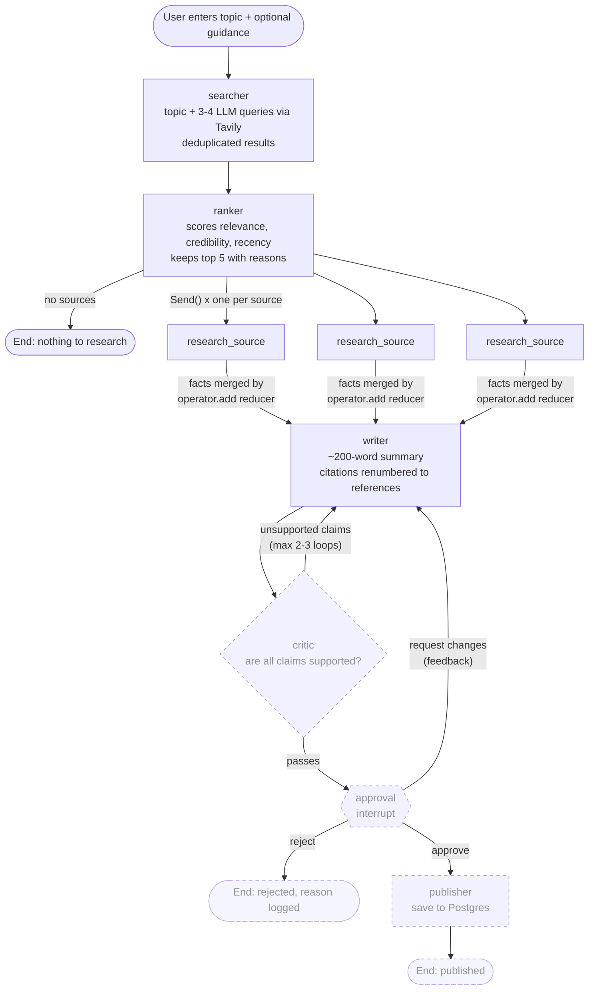

# Automated Content Creation (multi-agent, LangGraph)

A multi-agent pipeline built with **LangGraph**. The user enters a topic. Agents search the web, rank the sources, research the topic and write a short (~200-word) summary with citations. A critic agent fact-checks the draft, and a human approves it before it is published.

This is a portfolio project meant to be deployed and shown, not a toy demo.

## Phases

| Phase | Scope |
|---|---|
| **Phase 1 (MVP)** | User enters a topic → search → rank → research → write → critic loop → **human approval** → publish (saved to Postgres and shown on an archive page) |
| Phase 2 | **Trend Scout** agent finds trending topics from Google Trends RSS, Hacker News, Wikipedia pageviews and Reddit; the human picks one or enters their own (first human-in-the-loop checkpoint) |
| Phase 3 (stretch) | Scheduled daily runs, short video generation (script → TTS → video), social posting, evals dashboard |

## Phase 1 graph

Solid boxes are built; dashed boxes are planned.



Today the graph ends after `writer`; the critic edge replaces `writer -> END` next.

The research step is a **map-reduce fan-out**: `fan_out_to_researchers` returns one `Send("research_source", ResearchTask)` per ranked source, so the workers run in parallel and each one sees only its own source. Each worker returns `{"facts": [...]}`, and the `operator.add` reducer on `State.facts` concatenates the results instead of letting the last worker overwrite the others.

The human approval step uses LangGraph `interrupt()`. The graph pauses, its state is saved by the **Postgres checkpointer**, and the run resumes later through `Command(resume=...)` when the user approves, requests changes or rejects.

## Shared state

Defined in [content_agent/graph/state.py](content_agent/graph/state.py):

```python
class State(TypedDict):
    # Input
    topic: str
    topic_source: Literal["user", "scout"]   # "scout" used in phase 2
    guidance: str | None                     # optional angle / audience note

    # Written by agents
    search_queries: list[str]
    search_results: list[SearchResult]       # searcher: url, title, snippet
    sources: list[RankedSource]              # ranker: + score, rank_reason (top 5)
    facts: Annotated[list[Fact], operator.add]   # research workers append in parallel
    draft: str                               # writer: text with [n] citation markers
    references: list[str]                    # writer: references[n-1] is the URL for [n]

    # Critic loop
    critic_notes: Annotated[list[str], operator.add]   # appended, never overwritten
    critic_passed: bool
    revision_count: int

    # Human approval
    human_feedback: str | None
    status: Literal["queued", "researching", "awaiting_approval", "approved", "rejected"]
```

`ResearchTask` (topic, guidance, one `RankedSource`) is the private input each `research_source` worker receives through `Send`; it is not part of `State`.

## Project structure

```
AutomatedContentCreation/
├── requirements.txt          # runtime dependencies
├── requirements-dev.txt      # dev tools (pytest, ruff, ipykernel, python-dotenv)
├── .env                      # API keys (git-ignored, see Setup)
├── docker-compose.yml        # local Postgres
├── .vscode/settings.json     # notebooks run from the project root
├── research/                 # notebooks + sample JSON: experiments before code moves into modules
│   ├── explore.ipynb
│   ├── search.ipynb / searcher.ipynb / ranker.ipynb / researcher.ipynb
│   └── sample_search.json, sample_state.json
├── content_agent/
│   ├── llm.py                # get_llm(role) / get_structured_llm(role, schema), per-role model via env
│   ├── graph/
│   │   ├── state.py          # State, SearchResult, RankedSource, Fact, ResearchTask
│   │   ├── prompts.py        # all LLM prompts
│   │   ├── builder.py        # wires nodes + edges into the graph
│   │   └── nodes/
│   │       ├── searcher.py   # plans queries, runs Tavily, deduplicates
│   │       ├── ranker.py     # scores and keeps top 5
│   │       ├── researcher.py # Send fan-out + per-source fact extraction
│   │       ├── writer.py     # draft + citation renumbering, revision prompt
│   │       ├── critic.py     # (planned)
│   │       ├── approval.py   # (planned) human-in-the-loop interrupt
│   │       └── publisher.py  # (planned)
│   ├── tools/
│   │   ├── search.py         # Tavily wrapper
│   │   └── fetch.py          # httpx + trafilatura page text extraction
│   └── api/
│       ├── main.py           # FastAPI app (in-memory runs, not yet wired to the graph)
│       └── schemas.py        # request/response models
├── ui/
│   └── app.py                # Streamlit UI: topic form, calls the API at $API_URL
└── tests/                    # (planned)
```

## Tech stack

- **LangGraph**: agent orchestration, conditional edges, interrupts
- **LangChain** (`init_chat_model`) with Anthropic Claude: LLM calls; structured output uses native JSON schema (`method="json_schema"`). Provider and model are set per role via `LLM_MODEL_<ROLE>` / `LLM_MODEL`
- **Tavily**: web search; **httpx + trafilatura**: page fetching and text extraction
- **Postgres** + `langgraph-checkpoint-postgres`: durable graph state
- **FastAPI + Uvicorn**: API
- **Streamlit**: minimal UI
- **LangSmith**: tracing / observability

## Setup (pip)

```bash
python -m venv .venv
source .venv/bin/activate              # Windows: .venv\Scripts\activate
python -m pip install -r requirements-dev.txt
docker compose up -d                   # start Postgres
```

Create `.env` in the project root with `ANTHROPIC_API_KEY` and `TAVILY_API_KEY`. Optional: `LLM_MODEL` or `LLM_MODEL_<ROLE>` (e.g. `LLM_MODEL_WRITER`) to override the default model, `LANGSMITH_*` for tracing, and `DATABASE_URL` once the checkpointer lands.

Run commands from the project root:

```bash
uvicorn content_agent.api.main:app --reload   # API on :8000
streamlit run ui/app.py                       # UI (API_URL defaults to http://localhost:8000)
```

## Planned API

| Method | Endpoint | Purpose |
|---|---|---|
| POST | `/runs` | Start a run with `{topic, guidance}` |
| GET | `/runs/{id}` | Run status, sources, draft |
| POST | `/runs/{id}/resume` | Human decision: `approve` / `request_changes` (+ feedback) / `reject` |

## Status

- [x] Project structure and dependencies
- [x] Local env + VS Code notebook setup
- [x] `state.py`: State schema
- [x] Tools: search + fetch (prototyped in `research/` notebooks)
- [x] Nodes: searcher → ranker → researcher (parallel `Send`) → writer
- [x] `llm.py`: per-role models, native JSON-schema structured output
- [ ] Researcher prompt: stop meta-facts ("the source does not state...")
- [ ] Critic node + revision loop
- [ ] `failed` status + routing for no-sources / no-draft
- [ ] Human approval interrupt + Postgres checkpointer
- [ ] FastAPI endpoints (`POST /runs`, `GET /runs/{id}` exist with in-memory storage; not wired to the graph)
- [ ] Minimal UI: topic input (done), live run view, approval screen
- [ ] Deploy
